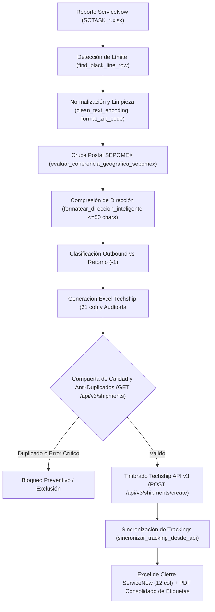
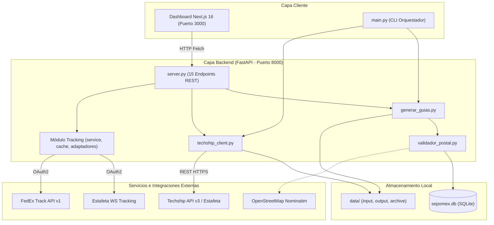

# Arquitectura Técnica del Sistema

Documento técnico de referencia sobre el diseño, componentes, integraciones y flujos del sistema de automatización de órdenes y rastreo de envíos (Seko Logistics / Kyndryl).

---

## 1. Flujo Completo Paso a Paso

El pipeline procesa los reportes operativos desde su ingesta hasta el timbrado y generación de entregables:

### Paso 1: Ingesta y Detección de Límites
- **Función**: `find_black_line_row(sheet)` en `src/generar_guias.py`.
- **Lógica**: Examina la hoja `Combined Report` del archivo Excel de ServiceNow buscando la fila vacía con relleno oscuro/negro que delimita las órdenes válidas del día, descartando registros y notas posteriores.

### Paso 2: Normalización y Limpieza de Caracteres
- **Funciones**: `clean_text_encoding()`, `format_zip_code()`, `validar_y_limpiar_telefono()` en `src/validador_postal.py` y `src/generar_guias.py`.
- **Lógica**: Corrige distorsiones de codificación UTF-8 / Latin-1 comunes en exportaciones de ServiceNow, formatea CPs a 5 dígitos con ceros iniciales y valida que los teléfonos contengan exactamente 10 dígitos numéricos.

### Paso 3: Validación Geográfica Oficial SEPOMEX ("Cero Alucinaciones")
- **Función**: `evaluar_coherencia_geografica_sepomex()` en `src/validador_postal.py`.
- **Lógica**: Cruza el código postal, estado y municipio contra la base de datos local SQLite (`data/sepomex.db`). Solo valida como coherente si el CP existe y concuerda con el municipio/estado oficial. No infiere datos inexistentes.

### Paso 4: Compresión Inteligente y Protección de Número Interior
- **Función**: `formatear_direccion_inteligente()` en `src/validador_postal.py`.
- **Lógica**: Estafeta REST impone un límite estricto de 50 caracteres por campo y no imprime `Address 3`. Si la calle excede 50 caracteres:
  1. Aplica abreviaturas viales oficiales (`Av.`, `Blvd.`, `Cda.`, `Depto`, `Int`).
  2. Extrae mediante regex (`REGEX_INTERIOR`) el número interior, departamento o piso y lo posiciona al inicio de `Address 2` para evitar su pérdida durante truncados.
  3. Trunca de forma limpia en límites de palabra si supera el espacio disponible.

### Paso 5: Clasificación de Envíos (Ida vs Retorno)
- **Envío Regular (Outbound / Ida)**:
  - Destinatario (`ShipTo`): Domicilio del empleado.
  - Remitente (`ShipFrom`): `None` (Techship utiliza el almacén central de Seko Lerma configurado por defecto).
  - Identificador: `KYNDRYL_{parent}`.
- **Retorno (`-1` / Recolección)**:
  - Destinatario (`ShipTo`): Almacén central de Seko Lerma fijo (Av. Lerma 1CBIS1 Int1A, San Pedro Tultepec, Lerma, CP 52030).
  - Remitente (`ShipFrom`): Domicilio del empleado (`HasShipFromAddress = True`).
  - Identificador: `{parent}`.

### Paso 6: Generación de Plantilla Techship y Auditoría
- Genera `data/output/Guias_Techship_Importada_*.xlsx` con las 61 columnas oficiales requeridas por Techship v3.
- Genera en paralelo `data/output/Auditoria_Direcciones_*.xlsx` con dos hojas: *Resumen Direcciones* (semáforo de calidad) e *Incidencias* (clasificadas en ERROR, REVISAR, CORREGIDO).

### Paso 7: Compuerta de Seguridad y Detección Anti-Duplicados
- **Función**: `verificar_orden_existente()` en `src/techship_client.py`.
- **Lógica**: Consulta `GET /api/v3/shipments` con el `CustomerOrder` (con y sin prefijo `KYNDRYL_`). Si el envío ya fue timbrado previamente o tiene estatus procesado, se omite para evitar retimbrados y cobros duplicados. Si contiene errores críticos en CP o dirección, se bloquea.

### Paso 8: Timbrado Oficial en Techship / Estafeta
- **Función**: `crear_shipment_api()` en `src/techship_client.py`.
- **Lógica**: En modo `--dry-run` solo valida el esquema contra la API; en modo `--live` envía `POST /api/v3/shipments/create` solicitando `labelPdfConversion=Enabled` para obtener la guía oficial de Estafeta.

### Paso 9: Sincronización de Cierre y PDF Consolidado
- **Función**: `sincronizar_tracking_desde_api()` en `src/techship_client.py`.
- **Lógica**: Consulta el detalle de los envíos timbrados, extrae la guía de 22 caracteres y el tracking de 10 dígitos (vía regex sobre la etiqueta), genera el archivo final `Cierre_DD_Mes_AAAA.xlsx` (12 columnas específicas para ServiceNow) y concatena las etiquetas individuales con `pypdf.PdfWriter` en `Etiquetas_Lote_DD_Mes_AAAA.pdf` manteniendo el orden por empleado (ida y retorno contiguos).

---

## 2. Integraciones Externas

| Servicio / Sistema | Tipo de Integración | Uso en el Proyecto | Variables de Entorno Asociadas |
| :--- | :--- | :--- | :--- |
| **Techship API v3** | REST HTTPS (API Key + Secret) | Generación de envíos (InputOrder), timbrado en Estafeta, validación anti-duplicados y descarga de etiquetas ZPL/PDF. | `TECHSHIP_API_KEY` `TECHSHIP_API_SECRET` `TECHSHIP_BASE_URL` `TECHSHIP_CLIENT_CODE` |
| **Estafeta REST Tracking** | OAuth2 Entra ID (CIAM) + API Key en header | Rastreo de eventos de entrega y tránsito en tiempo real para guías de 10 y 22 dígitos. | `ESTAFETA_CLIENT_ID` `ESTAFETA_CLIENT_SECRET` `ESTAFETA_API_KEY` `ESTAFETA_AUTH_URL` `ESTAFETA_TRACK_URL` `ESTAFETA_OAUTH_SCOPE` `ESTAFETA_SUBSCRIBER_ID` `ESTAFETA_SALES_ORG` `ESTAFETA_SERVICE_ID` `ESTAFETA_LABEL_URL` |
| **FedEx Track API v1** | OAuth2 Client Credentials | Rastreo multi-carrier de paquetes y retornos transportados por FedEx. | `FEDEX_CLIENT_ID` `FEDEX_CLIENT_SECRET` `FEDEX_BASE_URL` `FEDEX_LOCALE` |
| **SEPOMEX** | SQLite Local (`data/sepomex.db`) | Catálogo oficial de códigos postales, municipios y colonias de México (cero alucinaciones). | *Ninguna (base de datos local)* |
| **OpenStreetMap / Nominatim** | REST HTTPS | Validación de existencia física de direcciones y geocodificación de respaldo con caché local. | *Ninguna* |
| **ServiceNow** | Archivos Excel (`.xlsx`) | Ingesta de tickets de servicio (`Combined Report`) y exportación del archivo de Cierre de 12 columnas. | *Ninguna (intercambio por archivo)* |
| **n8n** | Flujos de automatización | Carpeta de recursos (`n8n/workflows/`). **Estado verificado**: La carpeta está actualmente vacía; no existe código activo de n8n, triggers ni webhooks dentro del repositorio. | *Ninguna* |

---

## 3. Endpoints del Backend (`src/api/server.py`)

El backend expone 15 endpoints HTTP centralizados en FastAPI:

| Método | Ruta | Efecto Real | Maneja `dry_run` | Autenticación Actual | Descripción |
| :--- | :--- | :---: | :---: | :--- | :--- |
| `GET` | `/api/health` | No | No | Ninguna | Healthcheck y timestamp del servidor. |
| `GET` | `/api/batches/current` | No | No | Ninguna | Lee y entrega en JSON el estado del lote activo. |
| `POST` | `/api/batches/upload` | **Sí** | No | Ninguna | Guarda reporte SCTASK y genera archivos Excel en disco. |
| `PATCH` | `/api/batches/order/{pick_order}` | **Sí** | No | Ninguna | Modifica celdas de dirección en los Excel del lote activo. |
| `POST` | `/api/batches/delete-orders` | **Sí** | No | Ninguna | Elimina órdenes de los Excel de guías y auditoría. |
| `DELETE` | `/api/batches/order/{order_id}` | **Sí** | No | Ninguna | Elimina una orden específica de los Excel del lote activo. |
| `POST` | `/api/techship/process` | **Sí** | **Sí** | Ninguna | Timbrado oficial en Techship / Estafeta (o simulación). |
| `POST` | `/api/techship/sync-closing` | **Sí** | No | Ninguna | Sincroniza trackings y genera Cierre Excel y PDF. |
| `GET` | `/api/techship/tracking` | No | No | Ninguna | Consulta guías asignadas del lote o Cierre reciente. |
| `GET` | `/api/files/download/{file_type}` | No | No | Ninguna | Descarga archivos generados (.xlsx o .pdf) vía navegador. |
| `POST` | `/api/batches/archive-previous` | **Sí** | **Sí** | Ninguna | Mueve archivos de trabajo hacia `data/archive/`. |
| `GET` | `/api/tracking/config-status` | No | No | `verify_tracking_auth`* | Reporta estado de credenciales de carriers y caché. |
| `POST` | `/api/tracking/batch` | No | No | `verify_tracking_auth`* | Rastreo concurrente de lote (hasta 50 guías). |
| `POST` | `/api/tracking/export-excel` | No | No | `verify_tracking_auth`* | Genera y transmite en memoria Excel de rastreo. |
| `GET` | `/api/tracking/{guia}` | No | No | `verify_tracking_auth`* | Rastreo unificado de una guía individual. |

*\*Nota sobre `verify_tracking_auth`: Valida `Authorization: Bearer <TOKEN>` únicamente si `TRACKING_API_AUTH_TOKEN` está configurado en `.env`. Si está vacío, permite acceso libre.*

---

## 4. Módulo de Rastreo Multi-Carrier (`src/tracking/`)

El módulo proporciona una capa de abstracción unificada para rastreo en tiempo real:

- **Servicio Orquestador (`TrackingService`)**: Coordina las consultas, detecta el carrier automáticamente (`detect_carrier()`) y gestiona llamadas concurrentes.
- **Caché en Memoria (`TrackingCache`)**:
  - Envíos en tránsito: TTL configurable por `TRACKING_CACHE_TTL_SECONDS` (default: 600 segundos / 10 minutos).
  - Envíos entregados: TTL extendido por `TRACKING_CACHE_DELIVERED_TTL_SECONDS` (default: 3600 segundos / 60 minutos) para evitar consultas innecesarias a APIs facturables.
- **Concurrencia y Rate Limiting**:
  - `SlidingWindowRateLimiter`: Limita a 120 peticiones por ventana de 60 segundos.
  - `asyncio.Semaphore`: Limita la concurrencia a `TRACKING_MAX_CONCURRENCY` (default: 8 consultas simultáneas).
- **Adaptadores**:
  - `FedExAdapter`: Conexión OAuth2 Client Credentials contra FedEx Track API v1.
  - `EstafetaAdapter`: Conexión OAuth2 Entra ID (CIAM) contra WS Pull Tracking.
- **Modo Simulación (`TRACKING_MOCK_FALLBACK`)**: Cuando está activo (`true`), si un carrier no tiene credenciales configuradas o su API no responde, genera respuestas sintéticas realistas para permitir pruebas operativas de interfaz sin afectar cuotas.

---

## 5. Arquitectura del Frontend (`frontend/`)

- **Tecnología**: Next.js 16.4 (App Router con Turbopack) y React 19 en TypeScript.
- **Vistas y Componentes**:
  - `frontend/src/app/page.tsx`: Dashboard maestro con subida de lotes, previsualización, edición de órdenes y botones de acción para timbrado y cierre.
  - `TrackingGenerator.tsx`: Generador de hoja de rastreo y visualización del PDF consolidado.
  - `TransportTracker.tsx`: Tablero de control de rastreo masivo con filtros por carrier, resumen de estados e historial.
- **Configuración de URL del Backend**:
  - Se define como `const API_BASE = process.env.NEXT_PUBLIC_API_URL || "http://localhost:8000"`.
  - No existen rewrites ni proxies configurados en `frontend/next.config.ts`.
- **Estrategia de Peticiones HTTP**:
  - Invocaciones directas mediante `window.fetch` inline en los manejadores de eventos (sin cliente centralizado tipo Axios o SWR).
  - Manejo de descargas binarias mediante `window.open` o blobs en memoria.
- **Control de Acceso (RBAC)**:
  - Los roles (`ADMIN`, `ASSET_MANAGER`, `CSM`, `ALMACEN`) se almacenan en memoria y `localStorage` del navegador.
  - El frontend envía las cabeceras `X-User-Email` y `X-User-Role` en el módulo de transporte, pero el backend no valida firmas ni sesiones criptográficas.

---

## 6. Riesgos y Puntos de Falla Conocidos

1. **Falta de Autenticación en Endpoints Críticos**: `POST /api/techship/process` permite disparar timbrado real y generar cobros en Estafeta sin validar identidad en el backend.
2. **Bloqueo de Archivos en Windows (`WinError 32`)**: Si un operador tiene abierto `Guias_Techship_Importada_*.xlsx` en Excel, cualquier intento de escritura falla con `PermissionError`.
3. **Bloqueo del Event Loop en FastAPI**: Tareas de E/S síncronas (`generar_guias`, `pd.read_excel`) corren en el hilo principal de asyncio en lugar de `run_in_threadpool`.
4. **Sincronización Secuencial de Trackings**: `sincronizar_tracking_desde_api` consulta orden por orden; en lotes de 60 órdenes puede tardar más de 2 minutos.
5. **Ausencia de Reintentos Exponenciales**: Errores 502/504 o microcortes marcan órdenes como error inmediatamente sin reintentos automáticos.
6. **Hardcoding de Datos Maestros**: Dirección de Seko Lerma, datos de contacto y dimensiones de caja están duplicados en múltiples scripts.
7. **Fragilidad de Mapeo en ServiceNow**: Si el reporte de ServiceNow cambia de columnas, el script cae en fallbacks por índice fijo que pueden desalinear datos.
8. **Exposición de Red por Defecto**: El backend corre en `0.0.0.0` con CORS completamente abierto (`*`), exponiendo la API a cualquier nodo de la red local.

---

## 7. Diagrama de Arquitectura del Sistema

